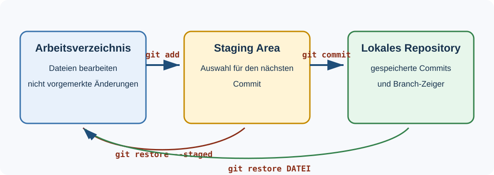
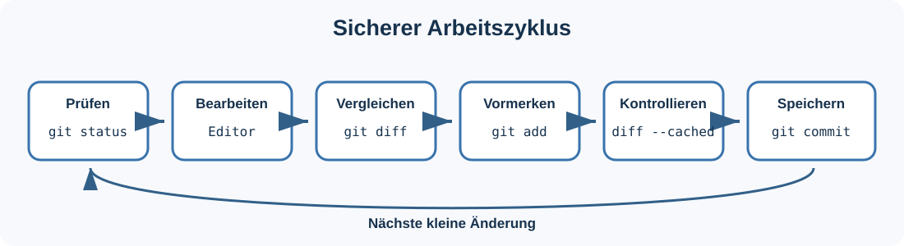
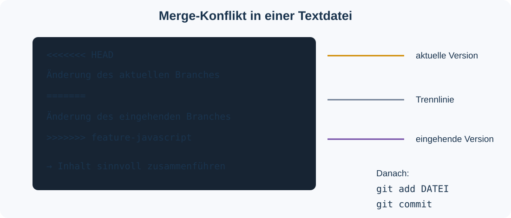
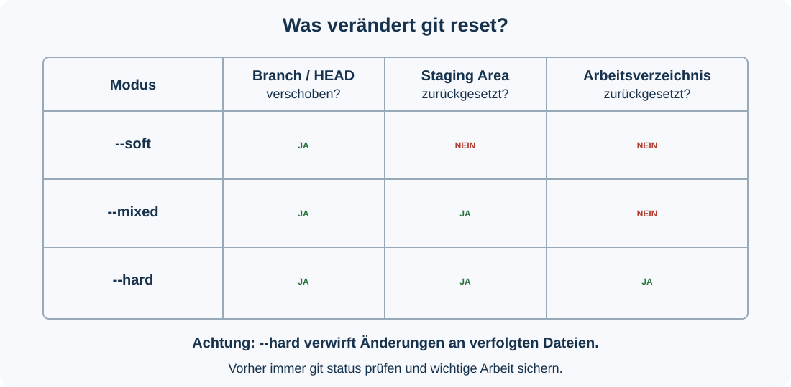

# Git-Übung: Branches, Merge-Konflikte und Reset

> **Szenario:** Sie entwickeln eine kleine Website mit HTML, CSS und JavaScript. CSS und JavaScript entstehen in getrennten Feature-Branches. Anschließend führen Sie beide Entwicklungsstände zusammen, lösen gezielt einen Merge-Konflikt und untersuchen die Reset-Modi `--soft`, `--mixed` und `--hard`.

## Inhaltsverzeichnis

- [1. Lernziele](#1-lernziele)
- [2. Voraussetzungen](#2-voraussetzungen)
- [3. Sicherheitsregeln](#3-sicherheitsregeln)
- [4. Repository vorbereiten](#4-repository-vorbereiten)
- [5. Git-Grundmodell](#5-git-grundmodell)
- [6. CSS-Feature entwickeln](#6-css-feature-entwickeln)
- [7. JavaScript-Feature entwickeln](#7-javascript-feature-entwickeln)
- [8. Branches zusammenführen](#8-branches-zusammenführen)
- [9. Merge-Konflikt lösen](#9-merge-konflikt-lösen)
- [10. Reset-Modi untersuchen](#10-reset-modi-untersuchen)
- [11. Hard Reset und Reflog](#11-hard-reset-und-reflog)
- [12. Selektives Zurücksetzen](#12-selektives-zurücksetzen)
- [13. Änderungen mit Stash parken](#13-änderungen-mit-stash-parken)
- [14. Projekt prüfen und veröffentlichen](#14-projekt-prüfen-und-veröffentlichen)
- [15. Reflexionsaufgaben](#15-reflexionsaufgaben)
- [16. Optionale Challenges](#16-optionale-challenges)
- [17. Befehlsübersicht](#17-befehlsübersicht)

---

## 1. Lernziele

Nach dieser Übung können Sie:

- den Zustand eines Repositorys mit `git status`, `git diff` und `git log` untersuchen,
- Feature-Branches erstellen und zwischen Branches wechseln,
- Änderungen gezielt zur Staging Area hinzufügen und committen,
- zwei Branches zusammenführen,
- einen absichtlich erzeugten Merge-Konflikt erkennen und lösen,
- die Auswirkungen von `git reset --soft`, `git reset --mixed` und `git reset --hard` erklären,
- einen entfernten Commit über das Reflog wiederfinden,
- einzelne Dateien aus der Staging Area entfernen sowie Änderungen mit `git stash` zwischenlagern.

**Geplante Arbeitszeit:** etwa 120 bis 180 Minuten, abhängig von Vorkenntnissen und Reflexionsumfang.

---

## 2. Voraussetzungen

Sie benötigen:

- Git auf Ihrem Computer,
- einen Texteditor oder eine Entwicklungsumgebung,
- einen aktuellen Webbrowser,
- ein GitHub-Konto,
- Zugriff auf das öffentliche Vorlagen-Repository,
- ein Terminal; unter Windows wird **Git Bash** empfohlen.

Prüfen Sie die Installation:

```bash
git --version
```

Eine Versionsnummer bestätigt, dass Git über das Terminal aufgerufen werden kann.

> **Hinweis zum Editor:** Die Übung ist nicht an `vi` gebunden. Sie können VS Code, Notepad++, IntelliJ IDEA, WebStorm oder einen anderen Texteditor verwenden. Wenn Sie `vi` verwenden: `i` startet den Einfügemodus, `Esc` beendet ihn, `:wq` speichert und beendet, `:q!` beendet ohne Speichern.

---

## 3. Sicherheitsregeln

1. Arbeiten Sie die Schritte **in der angegebenen Reihenfolge** ab.
2. Führen Sie Befehle nur im Ordner Ihres eigenen Übungs-Repositorys aus.
3. Prüfen Sie vor `reset`, `restore` und `clean` immer zuerst `git status`.
4. Verwenden Sie die gezeigten `--hard`-Befehle nur in dieser Übung.
5. Pushen Sie während der Reset-Versuche nicht. Veröffentlichen Sie erst den bereinigten Endstand.
6. Kopieren Sie keine unbekannten Commit-Hashes aus fremden Beispielen.

> [!WARNING]
> `git reset --hard` kann nicht gespeicherte Änderungen an **verfolgten Dateien** löschen. Ein gewöhnlicher Hard Reset entfernt nicht automatisch alle beliebigen unversionierten Dateien. Dafür wäre `git clean` zuständig, das in dieser Pflichtübung bewusst nicht verwendet wird.

---

## 4. Repository vorbereiten

### 4.1 Eigene Kopie erstellen

Das Repository unter `https://github.com/schwingi2/03_SWP_Git_uebungen` dient als öffentliche Vorlage. Erstellen Sie daraus ein Repository in Ihrem eigenen GitHub-Konto:

1. Öffnen Sie das Vorlagen-Repository im Browser.
2. Klicken Sie auf **Use this template** und anschließend auf **Create a new repository**.
3. Wählen Sie Ihr eigenes GitHub-Konto als Besitzer.
4. Vergeben Sie einen eindeutigen Namen, zum Beispiel `03_SWP_Git_uebungen_nachname`.
5. Erstellen Sie das Repository.
6. Kopieren Sie die HTTPS-Adresse **Ihres** neuen Repositorys.

> Falls die Schaltfläche **Use this template** nicht angezeigt wird, verwenden Sie **Fork**. Klonen Sie nicht direkt in ein gemeinsames Verzeichnis anderer Studierender.

### 4.2 Repository klonen

Ersetzen Sie `<IHRE-REPOSITORY-URL>` durch die kopierte HTTPS-Adresse:

```bash
git clone <IHRE-REPOSITORY-URL>
cd 03_SWP_Git_uebungen_nachname
```

Der genaue Ordnername entspricht dem Namen Ihres Repositorys.

### 4.3 Identität konfigurieren

Prüfen Sie zuerst die aktuelle Konfiguration:

```bash
git config --get user.name
git config --get user.email
```

Falls keine oder eine falsche Identität angezeigt wird, setzen Sie die Werte **nur für dieses Repository**:

```bash
git config user.name "Vorname Nachname"
git config user.email "ihre.email@example.com"
```

Die lokale Konfiguration vermeidet, dass Sie unbeabsichtigt die Einstellungen anderer Projekte verändern.

### 4.4 Ausgangszustand prüfen

```bash
git status
git branch --show-current
git remote -v
git log --oneline -5
```

Erwartungen:

- Der aktive Branch heißt `main`.
- Das Arbeitsverzeichnis ist sauber (`working tree clean`).
- `origin` verweist auf **Ihr** GitHub-Repository.
- Mindestens ein Starter-Commit ist vorhanden.

Prüfen Sie außerdem die Dateien:

```bash
ls -la
```

Unter Windows PowerShell können Sie alternativ `Get-ChildItem -Force` verwenden. Erwartet werden unter anderem `index.html`, `style.css`, `script.js`, `README.md`, `git-uebung.md` und der Ordner `images`.

> **Kontrollpunkt A:** Beginnen Sie erst mit Teil 5, wenn `git status` ein sauberes Arbeitsverzeichnis meldet.

---

## 5. Git-Grundmodell

Git unterscheidet drei zentrale Bereiche: das Arbeitsverzeichnis, die Staging Area und das lokale Repository.



- **Arbeitsverzeichnis:** Hier bearbeiten Sie Dateien.
- **Staging Area beziehungsweise Index:** Hier stellen Sie gezielt die Änderungen für den nächsten Commit zusammen.
- **Lokales Repository:** Hier speichert Git Commits dauerhaft in der lokalen Historie.

Ein sicherer Arbeitszyklus besteht aus Prüfen, Bearbeiten, Vergleichen, Vormerken, erneutem Kontrollieren und Committen.



Wichtige Prüfbefehle:

```bash
git status
git diff
git diff --cached
git log --oneline --graph --decorate --all
```

- `git diff` zeigt nicht vorgemerkte Änderungen im Arbeitsverzeichnis.
- `git diff --cached` zeigt Änderungen, die bereits für den nächsten Commit vorgemerkt sind.
- `git status` fasst den aktuellen Zustand zusammen.

---

## 6. CSS-Feature entwickeln

### 6.1 Branch erstellen

```bash
git switch -c feature-css-styling
```

`git switch -c` erzeugt einen neuen Branch und wechselt sofort dorthin. Prüfen Sie den aktiven Branch:

```bash
git branch
git status
```

Der Stern `*` muss vor `feature-css-styling` stehen.

### 6.2 Grundlegendes CSS einfügen

Ersetzen Sie den gesamten Inhalt von `style.css` durch:

```css
body {
    font-family: Arial, sans-serif;
    margin: 0;
    padding: 20px;
    background-color: #f0f0f0;
}

h1 {
    color: #333;
    border-bottom: 2px solid #007acc;
}

p {
    line-height: 1.6;
    color: #666;
}
```

Untersuchen Sie die Änderung:

```bash
git status
git diff -- style.css
```

Fügen Sie ausschließlich die CSS-Datei zur Staging Area hinzu und committen Sie sie:

```bash
git add style.css
git diff --cached
git commit -m "Add basic CSS styling"
```

### 6.3 CSS erweitern

Fügen Sie am Ende von `style.css` hinzu:

```css

.container {
    max-width: 800px;
    margin: 0 auto;
    background-color: white;
    padding: 30px;
    border-radius: 5px;
    box-shadow: 0 2px 5px rgba(0, 0, 0, 0.1);
}

.highlight {
    background-color: #ffeb3b;
    padding: 2px 4px;
}
```

Committen Sie diese logisch getrennte Erweiterung:

```bash
git add style.css
git commit -m "Add container and highlight classes"
```

### 6.4 HTML für CSS anpassen

Ersetzen Sie in `index.html` ausschließlich den Bereich von `<body>` bis `</body>` durch:

```html
<body>
    <div class="container">
        <h1>Willkommen</h1>
        <p class="highlight">Das ist meine erste Website mit modernem CSS-Design.</p>
        <p>Diese Seite zeigt schöne Gestaltung.</p>
    </div>
    <script src="script.js"></script>
</body>
```

Prüfen und committen Sie die Änderung:

```bash
git diff -- index.html
git add index.html
git commit -m "Update HTML for CSS integration"
```

### 6.5 CSS-Branch kontrollieren

```bash
git status
git log --oneline --decorate -5
```

> **Kontrollpunkt B:** Der Branch `feature-css-styling` muss sauber sein und drei neue Commits enthalten.

---

## 7. JavaScript-Feature entwickeln

### 7.1 Vom unveränderten main starten

Wechseln Sie zurück zu `main` und erstellen Sie dort den zweiten Feature-Branch:

```bash
git switch main
git switch -c feature-javascript
```

**Warum ist dieser Schritt wichtig?** Beide Feature-Branches sollen vom gleichen Starter-Stand abzweigen. Dadurch entwickeln sie sich unabhängig und ändern anschließend dieselbe Stelle in `index.html`. Genau das bereitet den beabsichtigten Merge-Konflikt vor.

Prüfen Sie:

```bash
git branch
git log --oneline --decorate --all --graph
```

### 7.2 JavaScript einfügen

Ersetzen Sie den gesamten Inhalt von `script.js` durch:

```javascript
// Website JavaScript Funktionalität

console.log("Website geladen!");

// Funktion für dynamischen Content
function addDynamicContent() {
    const body = document.body;
    const newParagraph = document.createElement('p');
    newParagraph.textContent = 'Dieser Text wurde mit JavaScript hinzugefügt!';
    newParagraph.className = 'highlight';
    body.appendChild(newParagraph);
}

// Event Listener für Seitenladung
document.addEventListener('DOMContentLoaded', function() {
    console.log('DOM ist bereit!');

    // Button für dynamischen Content hinzufügen
    const button = document.createElement('button');
    button.textContent = 'Dynamischen Content hinzufügen';
    button.onclick = addDynamicContent;
    document.body.appendChild(button);
});
```

Prüfen und committen Sie:

```bash
git diff -- script.js
git add script.js
git commit -m "Add dynamic JavaScript content"
```

### 7.3 HTML für JavaScript anpassen

Ersetzen Sie in `index.html` den Bereich von `<body>` bis `</body>` durch:

```html
<body>
    <div class="container">
        <h1>Willkommen auf meiner Website</h1>
        <p>Das ist meine erste Website mit <span class="highlight">JavaScript</span>-Funktionalität.</p>
        <p>Diese Seite demonstriert Git-Workflow-Features.</p>
    </div>
    <script src="script.js"></script>
</body>
```

Committen Sie:

```bash
git add index.html
git commit -m "Update HTML for JavaScript integration"
git status
```

> **Kontrollpunkt C:** `feature-javascript` muss sauber sein und zwei neue Commits enthalten. Wechseln Sie noch nicht zu einem anderen Branch, wenn ungespeicherte Änderungen vorhanden sind.

---

## 8. Branches zusammenführen

Der geplante Verlauf sieht so aus:


### 8.1 CSS in main mergen

```bash
git switch main
git merge feature-css-styling
```

Da `main` seit der Verzweigung unverändert geblieben ist, kann Git diesen Merge normalerweise als **Fast-Forward** durchführen. Dabei wird der `main`-Zeiger direkt auf den letzten Commit des CSS-Branches gesetzt; ein zusätzlicher Merge-Commit ist noch nicht nötig.

Prüfen Sie:

```bash
git status
git log --oneline --graph --decorate --all
```

### 8.2 JavaScript in main mergen

```bash
git merge feature-javascript
```

Git sollte den Merge anhalten und einen Konflikt in `index.html` melden. Das ist in dieser Übung beabsichtigt.

> [!IMPORTANT]
> Führen Sie jetzt keinen Reset aus und wechseln Sie nicht den Branch. Der angefangene Merge muss entweder gelöst oder mit `git merge --abort` vollständig abgebrochen werden.

---

## 9. Merge-Konflikt lösen

### 9.1 Konflikt untersuchen

```bash
git status
git diff -- index.html
```

Öffnen Sie anschließend `index.html`. Git kennzeichnet den nicht automatisch lösbaren Bereich mit Konfliktmarkierungen.



- `<<<<<<< HEAD` beginnt die Version des aktuell ausgecheckten Branches, hier `main` mit dem CSS-Stand.
- `=======` trennt beide Varianten.
- `>>>>>>> feature-javascript` beendet die eingehende JavaScript-Variante.

### 9.2 Gemeinsame Fassung herstellen

Ersetzen Sie den **gesamten Inhalt** von `index.html` durch die folgende konfliktfreie Version:

```html
<!DOCTYPE html>
<html lang="de">
<head>
    <meta charset="UTF-8">
    <meta name="viewport" content="width=device-width, initial-scale=1.0">
    <title>Meine Website</title>
    <link rel="stylesheet" href="style.css">
</head>
<body>
    <div class="container">
        <h1>Willkommen auf meiner Website</h1>
        <p>Das ist meine erste Website mit <span class="highlight">JavaScript</span>-Funktionalität und modernem CSS-Design.</p>
        <p>Diese Seite demonstriert Git-Workflow-Features mit schöner Gestaltung.</p>
    </div>
    <script src="script.js"></script>
</body>
</html>
```

Prüfen Sie sorgfältig, dass keine der Markierungen `<<<<<<<`, `=======` oder `>>>>>>>` übrig geblieben ist.

### 9.3 Lösung vormerken

```bash
git add index.html
git status
git diff --cached
```

`git add` bedeutet in diesem Kontext nicht nur „Datei hinzufügen“, sondern markiert den Konflikt für diese Datei als gelöst.

### 9.4 Merge abschließen

```bash
git commit -m "Merge JavaScript feature and resolve HTML conflict"
git status
git log --oneline --graph --decorate --all
```

> **Kontrollpunkt D:** `main` muss sauber sein. Die Historie zeigt jetzt beide Feature-Linien und einen Merge-Commit.

> **Notausgang:** Solange der Merge noch nicht committet wurde, können Sie mit `git merge --abort` zum Zustand vor dem Merge-Versuch zurückkehren. Verwenden Sie dies nur, wenn Sie den Lösungsvorgang vollständig neu beginnen müssen.

---

## 10. Reset-Modi untersuchen

`git reset` kann drei Ebenen beeinflussen: den aktuellen Branch-Zeiger, die Staging Area und das Arbeitsverzeichnis. Die folgenden Experimente werden ausschließlich lokal durchgeführt.



| Modus | Branch/HEAD | Staging Area | Arbeitsverzeichnis |
|---|---|---|---|
| `--soft` | wird verschoben | bleibt unverändert | bleibt unverändert |
| `--mixed` | wird verschoben | wird zurückgesetzt | bleibt unverändert |
| `--hard` | wird verschoben | wird zurückgesetzt | wird zurückgesetzt |

### 10.1 Zwei fehlerhafte Commits erzeugen

Fügen Sie am Ende von `script.js` bewusst diesen fehlerhaften Code ein:

```javascript

// FEHLER: nur für die Reset-Übung
function brokenFunction() {
    console.log("Dies ist ein Fehler);
    undefinedVariable.someMethod();
}

brokenFunction();
```

Committen Sie ihn:

```bash
git add script.js
git commit -m "Add broken JavaScript for reset exercise"
```

Ersetzen Sie danach den gesamten Inhalt von `README.md` durch:

```markdown
# FALSCHE DOKUMENTATION

Diese Dokumentation ist absichtlich falsch und soll zurückgenommen werden.

- Alles ist kaputt.
- Nichts funktioniert.
- Bitte nicht verwenden.
```

Committen Sie auch diese Änderung:

```bash
git add README.md
git commit -m "Add wrong documentation for reset exercise"
git log --oneline -5
```

Notieren Sie die beiden obersten Commit-Kurz-Hashes in Ihren Unterlagen.

### 10.2 Soft Reset ausführen

```bash
git reset --soft HEAD~1
git status
git diff --cached
git diff
```

Beobachtung:

- `HEAD~1` bezeichnet den ersten Vorfahren des vorher aktuellen Commits.
- Der Commit mit der falschen Dokumentation ist nicht mehr die Spitze von `main`.
- Die README-Änderung bleibt in der Staging Area.
- Der Inhalt im Arbeitsverzeichnis bleibt erhalten.

Beantworten Sie schriftlich:

1. Welche Datei steht unter `Changes to be committed`?
2. Warum liefert `git diff` für diese Datei keinen normalen, nicht vorgemerkten Unterschied?
3. Wofür wäre dieser Modus bei einer falschen Commit-Nachricht nützlich?

### 10.3 Mixed Reset ausführen

Führen Sie nun vom aktuellen Stand einen weiteren Commit-Schritt zurück:

```bash
git reset --mixed HEAD~1
git status
git diff --cached
git diff
```

Da `--mixed` der Standardmodus ist, wäre `git reset HEAD~1` gleichbedeutend.

Beobachtung:

- Der Branch-Zeiger steht wieder auf dem sauberen Merge-Ergebnis.
- Die Staging Area wurde an diesen Commit angepasst.
- Die falsche README und der fehlerhafte JavaScript-Code liegen weiterhin im Arbeitsverzeichnis, jetzt aber als nicht vorgemerkte Änderungen vor.

Beantworten Sie schriftlich:

1. Welche Dateien stehen unter `Changes not staged for commit`?
2. Ist die Staging Area leer?
3. Welcher Unterschied besteht zum Soft Reset?

### 10.4 Dateien korrigieren

Stellen Sie `script.js` aus dem aktuellen Commit wieder her:

```bash
git restore script.js
```

Ersetzen Sie `README.md` durch die korrekte Projektdokumentation:

```markdown
# Website-Projekt

Eine einfache HTML-Website für Git-Übungen.

## Features

- HTML-Grundstruktur
- CSS-Styling mit modernem Design
- JavaScript-Funktionalität für dynamischen Content
- responsives Container-Layout

## Verwendung

Öffnen Sie `index.html` in einem Webbrowser.

## Git-Übungen

Dieses Projekt dient als Übungsbeispiel für:

- Branch-Management
- Lösen von Merge-Konflikten
- Reset-Operationen
```

Prüfen und committen Sie:

```bash
git status
git diff
git add README.md
git diff --cached
git commit -m "Update project documentation"
git status
```

> **Kontrollpunkt E:** `script.js` enthält keinen fehlerhaften Zusatz mehr. `README.md` beschreibt den fertigen Projektstand. Das Arbeitsverzeichnis ist sauber.

---

## 11. Hard Reset und Reflog

In diesem Teil erstellen Sie zuerst einen eigenen problematischen Commit. Dadurch kann `--hard` gefahrlos und nachvollziehbar auf genau diesen Übungs-Commit angewendet werden.

### 11.1 Problematischen Commit erstellen

Fügen Sie am Ende von `index.html` außerhalb des schließenden `</html>`-Tags ein:

```html
<p>DIESER TEXT STEHT AN DER FALSCHEN STELLE.</p>
```

Erstellen Sie zusätzlich eine temporäre Datei:

```bash
echo "Diese Datei soll durch den Hard Reset verschwinden." > temp-fehler.txt
```

Committen Sie beide Fehler:

```bash
git add index.html temp-fehler.txt
git commit -m "Add temporary broken files for hard reset demo"
```

Speichern Sie den vollständigen Hash in einer Shell-Variablen:

```bash
FEHLER_COMMIT=$(git rev-parse HEAD)
echo "$FEHLER_COMMIT"
```

Diese Schreibweise funktioniert in Bash und Git Bash. In PowerShell verwenden Sie stattdessen:

```powershell
$FEHLER_COMMIT = git rev-parse HEAD
$FEHLER_COMMIT
```

### 11.2 Hard Reset durchführen

```bash
git reset --hard HEAD~1
git status
tail -n 5 index.html
ls temp-fehler.txt
```

Erwartung:

- Der problematische Commit ist nicht mehr die Spitze von `main`.
- Die zusätzliche HTML-Zeile ist verschwunden.
- `temp-fehler.txt` ist verschwunden, weil sie im entfernten Commit eine **verfolgte Datei** war und im Ziel-Commit nicht existiert.
- `git status` meldet ein sauberes Arbeitsverzeichnis.

### 11.3 Commit mit Reflog wiederfinden

```bash
git reflog --oneline -10
```

Das Reflog protokolliert lokale Bewegungen von `HEAD`. Der eben entfernte Commit sollte weiterhin mit seiner Nachricht sichtbar sein.

Stellen Sie den Übungs-Commit testweise wieder her:

```bash
git reset --hard "$FEHLER_COMMIT"
```

In PowerShell:

```powershell
git reset --hard $FEHLER_COMMIT
```

Prüfen Sie, dass die fehlerhafte HTML-Zeile und `temp-fehler.txt` wieder vorhanden sind. Entfernen Sie den Übungs-Commit danach erneut:

```bash
git reset --hard HEAD~1
git status
```

> **Kontrollpunkt F:** Das Repository ist wieder sauber, `temp-fehler.txt` existiert nicht und `index.html` endet mit `</html>`.

---

## 12. Selektives Zurücksetzen

### 12.1 Zwei Dateien verändern

Fügen Sie am Ende von `style.css` hinzu:

```css

/* Teständerung: wird nicht committet */
```

Fügen Sie in `index.html` unmittelbar vor `</body>` hinzu:

```html
    <!-- Teständerung: wird nicht committet -->
```

Nehmen Sie beide Dateien in die Staging Area auf:

```bash
git add index.html style.css
git status
git diff --cached
```

### 12.2 Eine Datei aus der Staging Area entfernen

```bash
git restore --staged style.css
git status
```

Erwartung:

- `index.html` bleibt vorgemerkt.
- `style.css` ist weiterhin verändert, aber nicht mehr vorgemerkt.
- Keine der beiden Arbeitskopien wurde durch `--staged` gelöscht.

Entfernen Sie nun beide Teständerungen:

```bash
git restore --staged index.html
git restore index.html style.css
git status
```

> `git restore --staged DATEI` verändert die Auswahl für den nächsten Commit. `git restore DATEI` überschreibt dagegen die nicht committeten Änderungen dieser Datei im Arbeitsverzeichnis.

---

## 13. Änderungen mit Stash parken

### 13.1 Zwischenstand erzeugen

Fügen Sie am Ende von `README.md` eine neue Zeile ein:

```markdown
In Arbeit: zusätzliche Dokumentation.
```

Prüfen Sie den Status und parken Sie die Änderung:

```bash
git status
git stash push -m "README-Zwischenstand"
git status
git stash list
```

Das Arbeitsverzeichnis sollte nun wieder sauber sein.

### 13.2 Zwischenstand zurückholen

```bash
git stash pop
git status
git diff -- README.md
```

`pop` wendet den obersten Stash an und entfernt ihn bei erfolgreicher Anwendung aus der Stash-Liste.

Da die Testzeile nicht Teil des Endprodukts sein soll, verwerfen Sie sie:

```bash
git restore README.md
git status
```

---

## 14. Projekt prüfen und veröffentlichen

### 14.1 Branches kontrollieren

```bash
git branch
git log --oneline --graph --decorate --all
git status
```

Der aktive Branch muss `main` sein. Das Arbeitsverzeichnis muss sauber sein.

Optional können Sie die inzwischen gemergten lokalen Feature-Branches löschen:

```bash
git branch -d feature-css-styling
git branch -d feature-javascript
```

Das Löschen der Branch-Zeiger entfernt die bereits in `main` enthaltenen Commits nicht.

### 14.2 Website testen

Öffnen Sie `index.html` im Browser und prüfen Sie:

- Die Seite zeigt einen weißen Container auf hellgrauem Hintergrund.
- Die Überschrift besitzt eine blaue Unterstreichung.
- Das Wort „JavaScript“ ist gelb hervorgehoben.
- Ein Button mit der Beschriftung „Dynamischen Content hinzufügen“ erscheint.
- Ein Klick fügt einen neuen hervorgehobenen Absatz ein.
- Die Browser-Konsole zeigt `Website geladen!` und `DOM ist bereit!`.
- Unterhalb von `</html>` steht kein Text wie `testit` oder eine andere Testzeile.

### 14.3 Endstand veröffentlichen

Prüfen Sie vor dem Push noch einmal:

```bash
git status
git remote -v
git log --oneline -5
```

Veröffentlichen Sie anschließend `main`:

```bash
git push -u origin main
```

> Falls Git den Push ablehnt, verwenden Sie **nicht sofort** `--force`. Lesen Sie die Meldung, prüfen Sie `git remote -v` und holen Sie bei Bedarf Unterstützung.

### 14.4 Abgabecheckliste

- [ ] Eigenes GitHub-Repository wurde verwendet.
- [ ] Der Branch `main` enthält den bereinigten Endstand.
- [ ] Der Merge-Commit ist in der Historie sichtbar.
- [ ] `git status` meldet ein sauberes Arbeitsverzeichnis.
- [ ] Die Website funktioniert im Browser.
- [ ] Die falsche Dokumentation und der fehlerhafte JavaScript-Code sind entfernt.
- [ ] `temp-fehler.txt` und alle Teständerungen sind entfernt.
- [ ] Der aktuelle Stand wurde zu GitHub gepusht.
- [ ] Die Reflexionsfragen wurden beantwortet.

---

## 15. Reflexionsaufgaben

Beantworten Sie die Fragen schriftlich in vollständigen, fachlich präzisen Sätzen.

### 15.1 Repository und Staging Area

1. Welchen Zweck erfüllt die Staging Area?
2. Worin unterscheiden sich `git diff` und `git diff --cached`?
3. Warum ist `git add .` bei großen Änderungen oft weniger kontrolliert als `git add DATEI`?

### 15.2 Branches und Merge

1. Warum entstanden die Änderungen für CSS und JavaScript in getrennten Branches?
2. Warum war der erste Merge ein Fast-Forward?
3. Warum entstand beim zweiten Merge ein Konflikt in `index.html`?
4. Welche Bedeutung haben `HEAD`, `=======` und der Branch-Name in den Konfliktmarkierungen?
5. Was bewirkt `git add index.html` nach der manuellen Konfliktlösung?

### 15.3 Reset

1. Welche Bereiche verändert `git reset --soft HEAD~1`?
2. Welche zusätzliche Wirkung hat `git reset --mixed HEAD~1`?
3. Warum ist `git reset --hard` gefährlich?
4. Warum wurde `temp-fehler.txt` in dieser Übung durch den Hard Reset entfernt?
5. Warum würde ein Hard Reset eine beliebige, nie versionierte Notizdatei normalerweise nicht automatisch entfernen?
6. Was bedeutet `HEAD~1`?
7. Wie half das Reflog bei der Wiederherstellung des entfernten Commits?

### 15.4 Praktische Situationen

1. Der letzte lokale Commit enthält die richtigen Änderungen, aber eine schlechte Commit-Nachricht. Welche Vorgehensweise ist geeignet?
2. Sie möchten den letzten lokalen Commit auflösen und seine Änderungen als nicht vorgemerkte Änderungen behalten. Welcher Modus passt?
3. Eine nicht committete Änderung an einer verfolgten Datei soll verworfen werden. Welcher Befehl eignet sich?
4. Sie müssen kurzfristig den Branch wechseln, möchten aber unfertige Änderungen noch nicht committen. Welches Werkzeug verwenden Sie?
5. Warum sollte veröffentlichte, gemeinsam genutzte Historie nicht ohne Abstimmung mit `reset` und Force Push umgeschrieben werden?

---

## 16. Optionale Challenges

### 16.1 Commit-Nachricht korrigieren

Erstellen Sie eine harmlose Änderung und committen Sie sie mit einer absichtlich ungenauen Nachricht. Korrigieren Sie nur die Nachricht des **noch nicht gepushten** letzten Commits:

```bash
git commit --amend -m "Describe the change precisely"
```

Vergleichen Sie die Commit-Hashes vor und nach `--amend`.

### 16.2 Drei Commits interaktiv bearbeiten

Erstellen Sie drei kleine, sinnvolle Commits in einer separaten Übungsdatei. Starten Sie anschließend:

```bash
git rebase -i HEAD~3
```

Experimentieren Sie nur auf einem nicht veröffentlichten Übungs-Branch mit `reword`, `squash` oder `drop`. Sichern Sie vorher den Branch:

```bash
git branch backup-before-rebase
```

### 16.3 GitHub Pages

Veröffentlichen Sie die fertige statische Website optional über GitHub Pages. Verwenden Sie dafür den Branch `main` und den Repository-Stamm als Quelle. Notieren Sie die veröffentlichte URL in Ihren Abgabeunterlagen.

---

## 17. Befehlsübersicht

| Befehl | Zweck |
|---|---|
| `git status` | Zustand von Arbeitsverzeichnis und Staging Area anzeigen |
| `git diff` | nicht vorgemerkte Änderungen anzeigen |
| `git diff --cached` | vorgemerkte Änderungen anzeigen |
| `git switch -c NAME` | neuen Branch erstellen und aktivieren |
| `git switch NAME` | vorhandenen Branch aktivieren |
| `git add DATEI` | Dateiänderung für den nächsten Commit vormerken |
| `git commit -m "..."` | vorgemerkte Änderungen als Commit speichern |
| `git merge BRANCH` | Änderungen eines Branches in den aktuellen Branch integrieren |
| `git merge --abort` | noch nicht abgeschlossenen Merge abbrechen |
| `git reset --soft HEAD~1` | Branch zurücksetzen; Staging Area und Dateien behalten |
| `git reset --mixed HEAD~1` | Branch und Staging Area zurücksetzen; Dateien behalten |
| `git reset --hard HEAD~1` | Branch, Staging Area und verfolgte Dateien zurücksetzen |
| `git restore DATEI` | nicht committete Dateiänderung verwerfen |
| `git restore --staged DATEI` | Datei aus der Staging Area entfernen |
| `git reflog` | lokale Bewegungen von `HEAD` anzeigen |
| `git stash push` | unfertige Änderungen vorübergehend parken |
| `git stash pop` | zuletzt geparkte Änderungen anwenden und Stash entfernen |
| `git log --graph --all` | verzweigte Historie grafisch im Terminal anzeigen |
| `git push -u origin main` | lokalen `main` veröffentlichen und Upstream setzen |

## Offizielle Dokumentation

- [Git: git-reset](https://git-scm.com/docs/git-reset)
- [Git: git-merge](https://git-scm.com/docs/git-merge)
- [Git: git-reflog](https://git-scm.com/docs/git-reflog)
- [GitHub: Repository aus einer Vorlage erstellen](https://docs.github.com/en/repositories/creating-and-managing-repositories/creating-a-repository-from-a-template)
- [GitHub: Lokalen Code zu GitHub hinzufügen](https://docs.github.com/en/migrations/importing-source-code/using-the-command-line-to-import-source-code/adding-locally-hosted-code-to-github)
